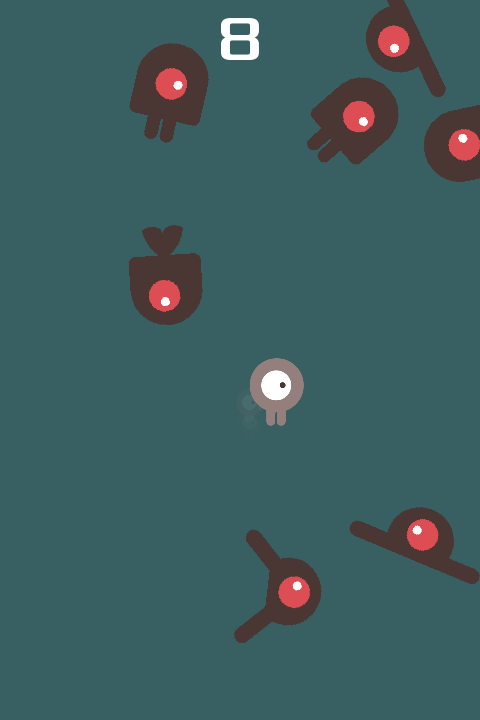
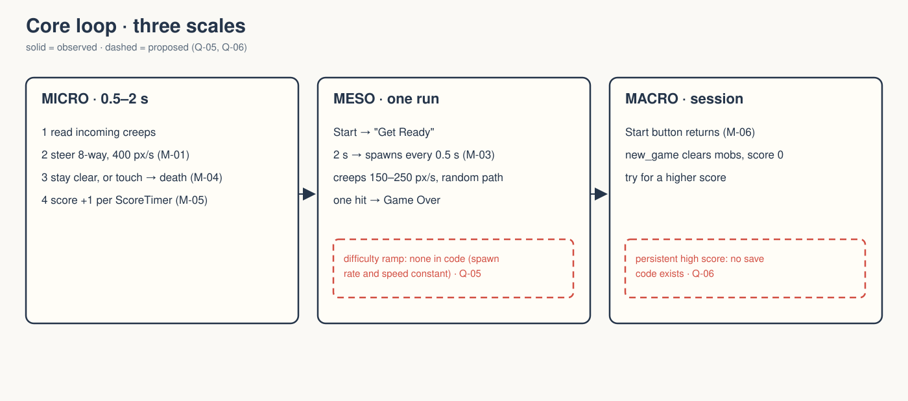
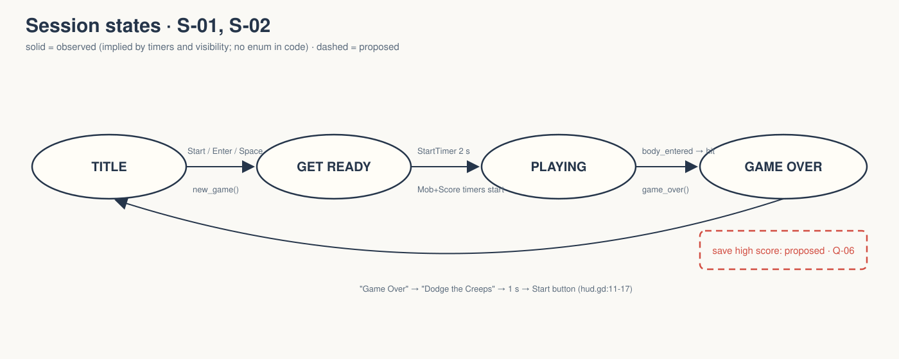

# walker-2d-dodge-the-creeps: Game Design Document (recovered)

| | |
|---|---|
| Version | 0.1.0-recovered |
| Date | 2026-09-27 |
| Author | Zelda (agent, silent), for Nik Bear Brown |
| Mode | recovered · `/gdd reverse --path godot silent` |
| Revision | 1 |
| Gates | vision ○ · systems ○ · world ○ · scope ○. Gate unsigned at time of writing |
| Classification | **A small, complete game** (upstream tutorial game): survive, score by time, one hit ends the run, restart. |

Provenance tags: `[OBSERVED path:line]` · `[INFERRED]` with evidence · `[MISSING]`. Paths are relative to `godot/` unless they start with the folder root. A recovered GDD describes what exists. It approves none of it.

*`godot/screenshots/dodge.png` (480×720, portrait), shipped upstream and referenced by `godot/README.md:25`. This is design art, not a Walker capture. The root `README.md` warns that a landscape film must not be confused with the native portrait layout.*

## 1. Vision summary

**Logline (upstream, observed).** "Your character must move and avoid the enemies for as long as possible" `[OBSERVED godot/README.md:3-4]`. It is the finished game from Godot's "Your first 2D game" tutorial `[OBSERVED godot/README.md:6-9]`.

**Player fantasy.** `[MISSING]` No text states one. `[INFERRED]` The game offers "outlast the swarm." Evidence: the score counts seconds survived (`main.gd:50-52`, ScoreTimer), and the title card reads "Dodge the Creeps" (`hud.gd:14`).

**Target player.** `[MISSING]` `[INFERRED]` Beginners following the tutorial, plus Walker film viewers.

**Why it is in Walker.** `[MISSING]` The folder's documents record verification and licensing, not a design intent for Walker.

**Biggest unresolved question.** Is Walker keeping this as the tutorial game it is, or growing it (difficulty ramp, high score)? Q-01.

## 2. Design pillars

`[MISSING]` None stated. `[INFERRED]` The code protects two properties. *One rule*: any touch ends the run (`player.gd:51-55` → `main.gd:6-11`). *Instant legibility*: one screen, one score, one message line (`hud.tscn:15-55`). Neither has been approved as a pillar.

## 3. Core loop

**Micro (0.5–2 s).** Read incoming creeps, steer with 8-way movement, keep clear `[OBSERVED player.gd:13-41; main.gd:24-47]`.
**Meso (one run).** Start → "Get Ready" → after 2 s, creeps spawn every 0.5 s and the score ticks once per ScoreTimer timeout → touch → Game Over `[OBSERVED main.gd:14-21,55-57; main.tscn:30-37]`.
**Macro (session).** Restart for a higher score. `[OBSERVED hud.gd:11-17]` The Start button returns after the game-over message. `[MISSING]` No persistent high score: no save code exists.
**Loop honesty test.** Strip the art: a dot avoids random linear projectiles, scoring time. Decisions exist (where to move), risk exists (one hit), reward is the score. Passes as a minimal arcade loop.

## 4. Player Experience Goals

`[MISSING]` None authored. Candidates `[INFERRED]`, not approved:

| ID | Candidate | Evidence |
|---|---|---|
| PX-01 | Tension rising while threats accumulate | spawns every 0.5 s, mobs persist until off-screen (`main.tscn:31`, `mob.gd:9-10`) |
| PX-02 | "One more try" after a loss | restart offered ~1 s after the message timer (`hud.gd:11-17`) |

## 5. Mechanics

### M-01 Eight-way movement `[OBSERVED player.gd:13-31]`
Four actions (`move_left/right/up/down`) are summed and normalized, then scaled by `speed = 400` px/s (exported, line 5). Position is clamped to the viewport. The walk animation plays only while moving. Test evidence: "diagonal motion normalized near 400px/s" and "left boundary clamps" pass (`input-fixed-20260924.log`).

### M-02 Facing `[OBSERVED player.gd:33-41]`
Horizontal motion uses the "right" animation with flip_h. Vertical motion uses "up", with rotation PI when moving down. **Walker fix:** line 34 resets `rotation = 0` in the horizontal branch. Before the fix, a down-then-right move kept the PI rotation, reproduced as a FAIL in `input-repro-20260924.log`.

### M-03 Creep spawning `[OBSERVED main.gd:24-47; main.tscn:30-31,42-45]`
Every 0.5 s a Mob is instanced at a random point on `MobPath`. It heads perpendicular to the path ± π/4, at a speed drawn from 150–250 px/s. Each mob picks a random animation (walk, swim or fly) (`mob.gd:3-6`). Mobs have `collision_mask = 0`, so they don't collide with each other (`mob.tscn:52`), and free themselves on leaving the screen (`mob.gd:9-10`).

### M-04 One-hit death `[OBSERVED player.gd:51-55; main.gd:6-11]`
The player Area2D `body_entered` hides the player, emits `hit`, and defers disabling its collider. `game_over()` stops both timers and the music, plays DeathSound, and shows "Game Over".

### M-05 Score `[OBSERVED main.gd:50-52; main.tscn:33]`
+1 per ScoreTimer timeout. The scene sets no `wait_time`, so `[INFERRED]` Godot's default of 1.0 s applies: the score is roughly seconds survived.

### M-06 Start / restart `[OBSERVED hud.gd:24-26; hud.tscn:6-10,40-55; project.godot:67-72]`
The Start button emits `start_game`. Its shortcut is the `start_game` action (Enter or Space). `new_game()` frees all mobs in group "mobs", resets the score, repositions the player at (240, 450), and starts the music.

Tuning values above are `[OBSERVED]` numbers, not approved design.

## 6. Systems

| ID | System | Owner | Evidence |
|---|---|---|---|
| S-01 | Run controller (timers, spawn, score, game over) | `Main` Node + `main.gd` | `[OBSERVED main.tscn:16-59]` |
| S-02 | HUD / messages / start button | `HUD` CanvasLayer + `hud.gd` | `[OBSERVED hud.tscn]` |
| S-03 | Player controller | `Player` Area2D + `player.gd` | `[OBSERVED player.tscn]` |
| S-04 | Mob | `Mob` RigidBody2D + `mob.gd` | `[OBSERVED mob.tscn]` |
| S-05 | Audio: looping music + death sting | `Music`, `DeathSound` AudioStreamPlayers | `[OBSERVED main.tscn:49-53]` |

No save/load and no scene transitions (a single scene) `[OBSERVED absence]`.

## 7. Progression

`[OBSERVED]` None inside a run. The spawn rate (0.5 s) and speed range (150–250) are constant, and no code raises difficulty. `[MISSING]` Whether a ramp is intended.

## 8. World

`[OBSERVED]` One portrait field, 480×720 (`project.godot:27-30`), a ColorRect background (`main.tscn:20`), and a spawn path around the edge (`main.tscn:42-45`). `[MISSING]` Setting or place.

## 9. Narrative

`[MISSING]` None. The only text is "Get Ready", "Game Over" and "Dodge the Creeps" (`main.gd:20`, `hud.gd:12,14`). No lore is invented here.

## 10. Characters

`[OBSERVED]` Player sprite `playerGrey_*`, and three creep types (flying, swimming, walking) from Kenney's Abstract Platformer (`godot/README.md:31`). `[MISSING]` Names or roles.

## 11. Features and priority

| ID | Feature | State | Evidence |
|---|---|---|---|
| F-01 | Movement + bounds (M-01) | headless-verified | `input-fixed-20260924.log` |
| F-02 | Facing + Walker rotation fix (M-02) | reproduced, fixed, verified | repro vs fixed logs |
| F-03 | Timed spawning (M-03) | headless-verified | "timer spawns mobs" |
| F-04 | Score (M-05) | headless-verified | "timed score updates label" |
| F-05 | Collision → game over (M-04) | verified with an **explicit fixture** (frozen mob placed at the player) | `FRICTIONAL.md:31-35` |
| F-06 | Restart (M-06) | headless-verified | "restart clears mobs" etc. |
| F-07 | Audio audibility, GPU trail, gamepad, off-screen cleanup, extended play | **unverified** | `FRICTIONAL.md:37-40` |

CORE percentage: not computed `[MISSING MVP definition]`. The game is already complete as shipped upstream.

## 12. Out of scope

`[OBSERVED absence]` Pause, lives, power-ups, levels, high-score persistence, menus beyond Start. No film is ready (`README.md:14`).

## 13. Technical

Godot 4.7, Compatibility renderer (`project.godot:22,76-77`). Viewport 480×720 with canvas-items stretch. Main scene `res://main.tscn`. Input actions: `move_left/right/up/down` (WASD, arrows, D-pad, left stick) and `start_game` (Enter, Space) (`project.godot:33-72`). The Player Area2D and the Mob RigidBody2D use default layer 1. The mob mask is 0. Test harness: `test_input.gd` (headless, synthetic key and mouse events, seed 123).

## 14. Risks

| ID | Risk | Evidence |
|---|---|---|
| R-01 | Landscape film framing misrepresents a portrait game | `README.md:15-16` |
| R-02 | The collision proof relies on a fixture, not natural play | `FRICTIONAL.md:31-33` |
| R-03 | Attribution omitted from film descriptions (CC-BY music) | `README.md:9-12` |
| R-04 | No difficulty ramp: a run may plateau | `[INFERRED]` constant timers |

## 15. Open questions

See `design/decisions.md`: Q-01 through Q-07.

## 16. Tests

Existing: `test_input.gd`, 14 checks passing (`input-fixed-20260924.log`). The pre-fix failure is kept in `input-repro-20260924.log`, and the harness parse errors in `input-20260924.log`.
Proposed (dashed): T-01 a natural (non-fixture) collision during scripted play. T-02 an extended run checking that off-screen mobs are freed. T-03 a gamepad route. H-01 a human plays five runs and reports the median score and whether they wanted another try (PX-02).

## Zelda's notes (silent mode; what I would have said out loud)

- **This one is a game, and it's a good small one.** One verb, one rule, one number. Don't let the film bury that under engine talk.
- **The Walker rotation fix is a real bug fix with a before/after log.** That's the story worth telling: the facing was wrong and a test proved it.
- **Flat difficulty is the design debt.** With no ramp, a good player's run is endless and a new player's is short for the same reason. If anyone wants to extend the game, start there, with a PX goal first.
